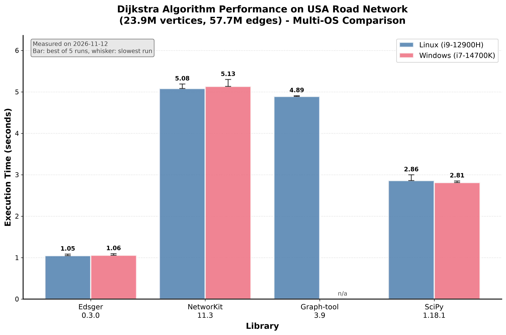

[](https://codecov.io/gh/aetperf/edsger)
[](https://edsger.readthedocs.io/en/latest/?badge=latest)
[](https://pypi.org/project/edsger/)
[](https://pepy.tech/project/edsger)
[](https://pypi.org/project/edsger/)
[](https://github.com/astral-sh/ruff)
[](https://github.com/MarcoGorelli/cython-lint)
[](https://github.com/astral-sh/ty)
[](https://opensource.org/licenses/MIT)

# Edsger

*Graph algorithms in Cython*

Edsger is a Python library of graph algorithms for directed graphs, written in [Cython](https://cython.org/). A graph is given as a dataframe of edges, from [pandas](https://pandas.pydata.org/) or [Polars](https://pola.rs/), and the results come back as [NumPy](https://numpy.org/) arrays, pandas Series or Polars DataFrames.

| Family | Classes |
|---|---|
| Shortest paths | `Dijkstra`, `BellmanFord`, `AStar`, `BidirectionalDijkstra` |
| Traversal and components | `BFS`, `DFS`, `ConnectedComponents` |
| Spanning trees and centrality | `MinimumSpanningTree`, `Centrality` (PageRank, HITS, Katz) |
| Transit assignment | `HyperpathGenerating` (Spiess and Florian's optimal strategies) |

Documentation: [https://edsger.readthedocs.io/en/latest/](https://edsger.readthedocs.io/en/latest/)

## Installation

```bash
pip install edsger
```

Edsger requires Python 3.10 or later. Wheels are published for Linux (x86_64), Windows and macOS (arm64).

## Example

```python
import pandas as pd

from edsger import Dijkstra

edges = pd.DataFrame(
    {
        "tail": [0, 0, 1, 2, 2, 3],
        "head": [1, 2, 2, 3, 4, 4],
        "weight": [1.0, 4.0, 2.0, 1.5, 3.0, 1.0],
    }
)

dijkstra = Dijkstra(edges)
dijkstra.run(vertex_idx=0)
```

    array([0. , 1. , 3. , 4.5, 5.5])

The result is the length of the shortest path from vertex 0 to each vertex of the graph. The graph is built once, and `run` can be called any number of times with different vertices. With `path_tracking=True`, the paths themselves can be retrieved.

```python
dijkstra.run(vertex_idx=0, path_tracking=True)
dijkstra.get_path(vertex_idx=4)
```

    array([4, 3, 2, 1, 0], dtype=uint32)

The other classes are described in the [quick start](https://edsger.readthedocs.io/en/latest/quickstart.html).

## Performance

Dijkstra's algorithm takes about one second on the USA road network of the [9th DIMACS implementation challenge](https://archive.dimacs.rutgers.edu/Workshops/Challenge9/), which has 23.9 million vertices and 57.7 million edges.



Single-source shortest paths from one vertex of the USA road network, best of 5 runs. The Linux and Windows timings come from two different machines. The method and the versions are given in the [benchmarks](https://edsger.readthedocs.io/en/latest/benchmarks.html) page.

## Contributing

Bug reports and pull requests are welcome on [GitHub](https://github.com/aetperf/Edsger/issues). See the [contributing](https://edsger.readthedocs.io/en/latest/contributing.html) page for the development setup.

## License

Edsger is distributed under the MIT License, see the [LICENSE](https://github.com/aetperf/Edsger/blob/release/LICENSE) file.

## Contact

François Pacull, [francois.pacull@architecture-performance.fr](mailto:francois.pacull@architecture-performance.fr)
